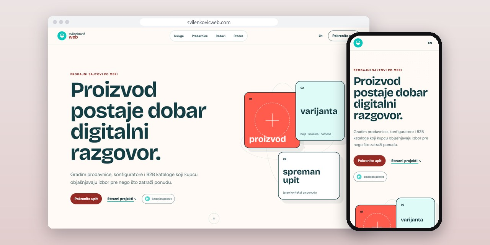
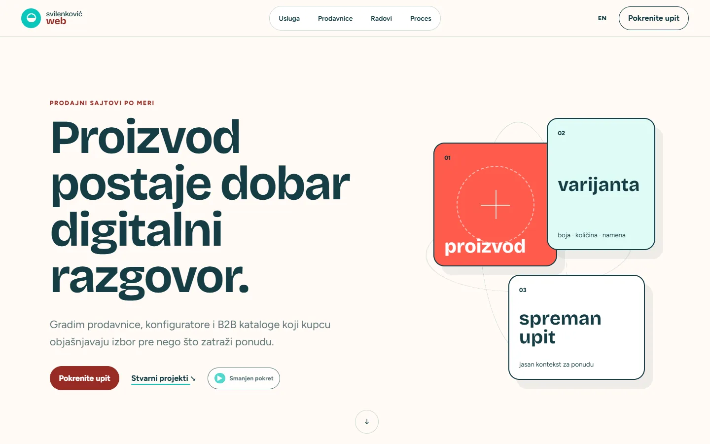
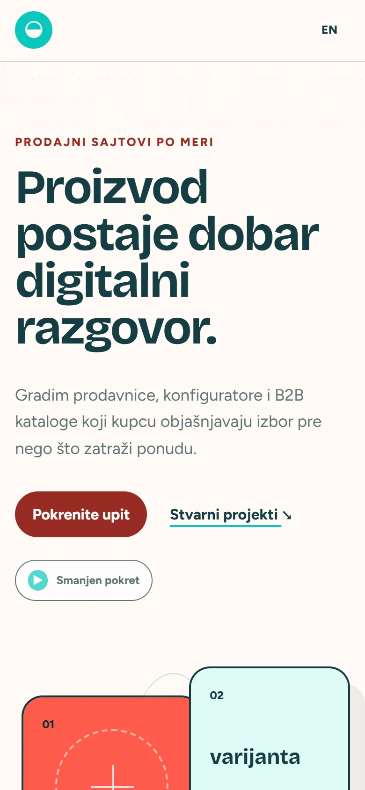
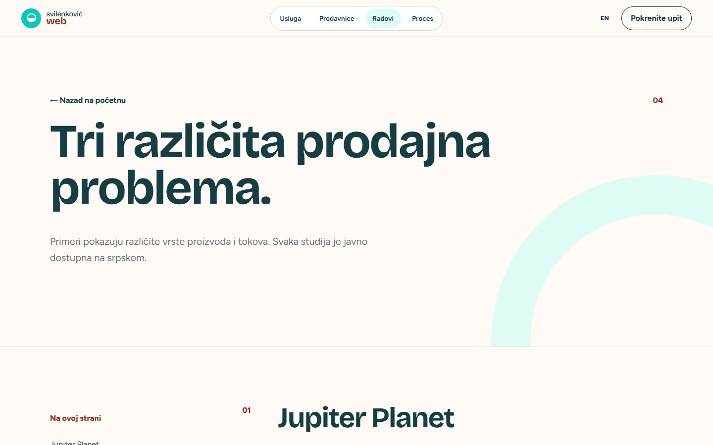

# Svilenković Web

A site about web shops and B2B catalogues that shows how the interface changes with the way a customer decides to buy.

**[svilenkovicweb.com](https://svilenkovicweb.com/)** · [Case study (in Serbian)](https://svilenkovic.rs/radovi/svilenkovic-web) · [Srpski](README.sr.md)

> [!NOTE]
> My own project, not client work. The source code is private. This page describes what the site does and how it is built.

<table>
  <tr><td><b>Client</b></td><td>Own project</td></tr>
  <tr><td><b>Industry</b></td><td>Web shops and B2B catalogues</td></tr>
  <tr><td><b>Location</b></td><td>Serbia</td></tr>
  <tr><td><b>Type</b></td><td>Multi-page website</td></tr>
  <tr><td><b>My role</b></td><td>Research, design, development, SEO and hosting</td></tr>
  <tr><td><b>Stack</b></td><td>Astro 7, TypeScript, PHP 8.3, SQLite, nginx</td></tr>
</table>

## About the project

Buying is not always a cart. One customer needs to pick a variant, another needs a clear catalogue, and a third wants to talk about a quote. Svilenković Web separates direct checkout, quote requests and B2B catalogues and shows how one product moves through each path.

The opening scene turns an object into a product card and then into a quote while the visitor scrolls, but the cards and text sit in plain HTML. The Work page compares three kinds of selling through projects I documented publicly (a configurator, a catalogue and an inquiry flow) without claiming conversions nobody measured.

## What I built

- Separate explanations for checkout, inquiry and B2B catalogue models
- Product data, variants and stock treated as inputs for the design
- A scroll scene that follows one item from object to quote
- A Work page that ties each selling problem to a documented project, including the Jupiter Planet configurator
- Layouts checked down to narrow phone widths

## Results

| | Performance | Accessibility | Best practices | SEO |
| :-- | :-: | :-: | :-: | :-: |
| Mobile | 100 | 100 | 100 | 100 |
| Desktop | 100 | 100 | 100 | 100 |

PageSpeed Insights, lab test of the live site, October 2026. Security headers: 6 of 6. Structured data: `Person`.

## Screenshots

<table>
  <tr>
    <td width="68%" valign="top"></td>
    <td width="32%" valign="top"></td>
  </tr>
</table>

Work page: three selling problems and the projects behind them

---

Built by [D. Svilenković](https://svilenkovic.com).
