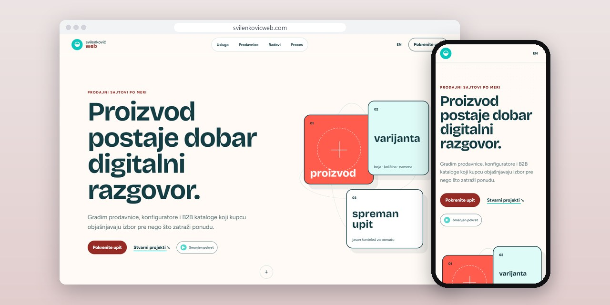
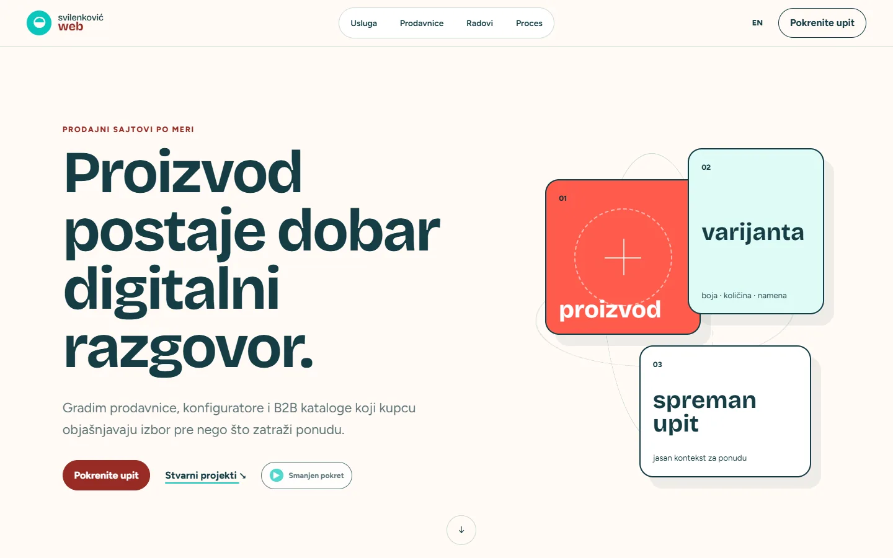
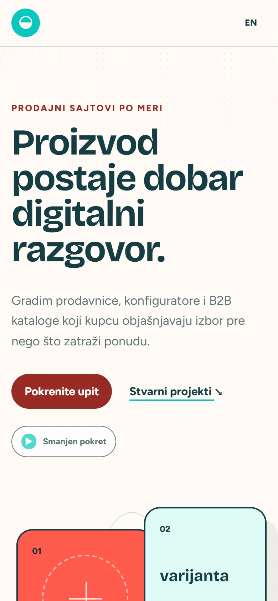
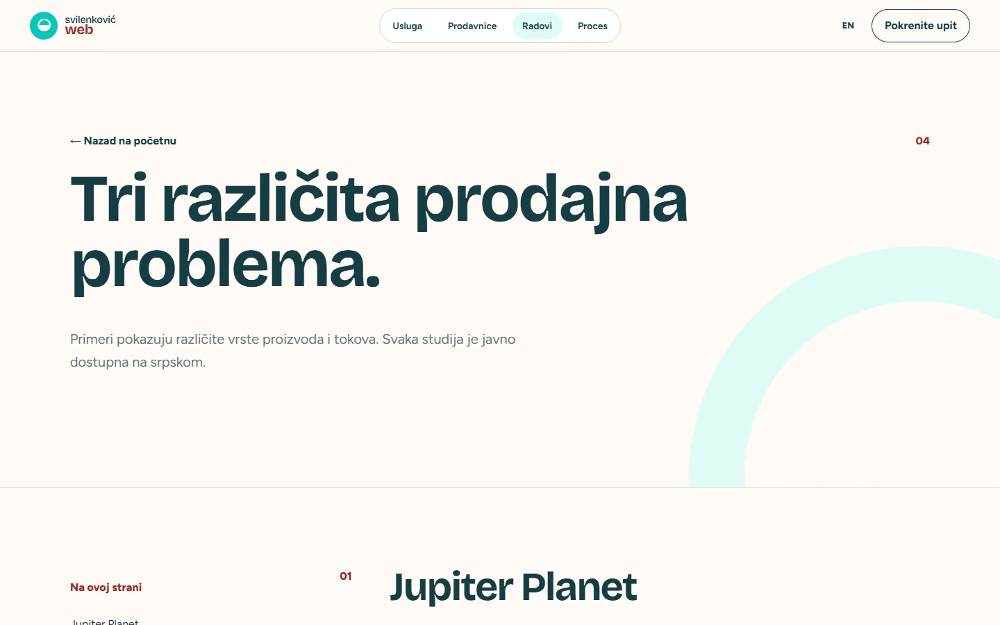

# Svilenković Web

Sajt o web prodavnicama i B2B katalozima koji pokazuje kako se interfejs menja prema načinu na koji kupac odlučuje.

**[svilenkovicweb.com](https://svilenkovicweb.com/)** · [Studija slučaja](https://svilenkovic.rs/radovi/svilenkovic-web) · [English](README.md)

> [!NOTE]
> Moj sopstveni projekat, ne klijentski posao. Izvorni kod je privatan. Ova stranica opisuje šta sajt radi i kako je napravljen.

<table>
  <tr><td><b>Klijent</b></td><td>Sopstveni projekat</td></tr>
  <tr><td><b>Delatnost</b></td><td>Web prodavnice i B2B katalozi</td></tr>
  <tr><td><b>Lokacija</b></td><td>Srbija</td></tr>
  <tr><td><b>Vrsta</b></td><td>Sajt sa više strana</td></tr>
  <tr><td><b>Moj deo posla</b></td><td>Istraživanje, dizajn, izrada, SEO i hosting</td></tr>
  <tr><td><b>Tehnologije</b></td><td>Astro 7, TypeScript, PHP 8.3, SQLite, nginx</td></tr>
</table>

## O projektu

Kupovina nije uvek korpa. Nekome treba izbor varijante, nekome jasan katalog, a nekome razgovor o ponudi. Svilenković Web razdvaja direktnu kupovinu, upit za ponudu i B2B katalog i pokazuje kako jedan proizvod prolazi kroz svaki od tih puteva.

Uvodna scena dok se skroluje pretvara predmet u karticu proizvoda, pa u ponudu, ali kartice i tekst stoje u običnom HTML-u. Strana Radovi poredi tri načina prodaje kroz projekte koje sam javno dokumentovao (konfigurator, katalog i tok upita), bez pripisivanja konverzija koje niko nije izmerio.

## Šta sam uradio

- Posebna objašnjenja za kupovinu preko korpe, upit i B2B katalog
- Podaci o proizvodu, varijante i zalihe kao polazna tačka dizajna
- Scena uz skrol koja prati jedan artikal od predmeta do ponude
- Strana Radovi koja svaki prodajni problem vezuje za dokumentovan projekat, među njima i konfigurator za Jupiter Planet
- Raspored proveren do uskih ekrana telefona

## Merenja

| | Performanse | Pristupačnost | Dobre prakse | SEO |
| :-- | :-: | :-: | :-: | :-: |
| Telefon | 100 | 100 | 100 | 100 |
| Desktop | 100 | 100 | 100 | 100 |

PageSpeed Insights, laboratorijsko merenje živog sajta, oktobar 2026. Sigurnosna zaglavlja: 6 od 6. axe provera pristupačnosti: bez prekršaja. Strukturisani podaci: `Organization`, `Person`.

## Snimci ekrana

<table>
  <tr>
    <td width="68%" valign="top"></td>
    <td width="32%" valign="top"></td>
  </tr>
</table>

Radovi: tri prodajna problema i projekti iza njih

---

Izrada: [D. Svilenković](https://svilenkovic.rs).
